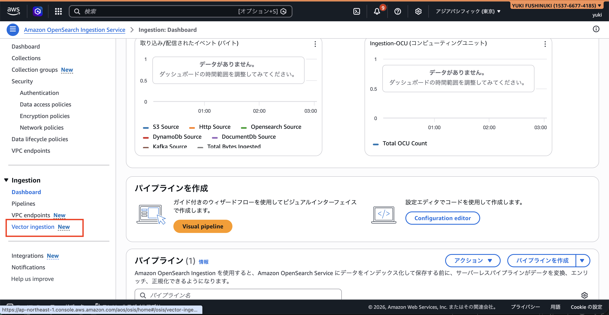
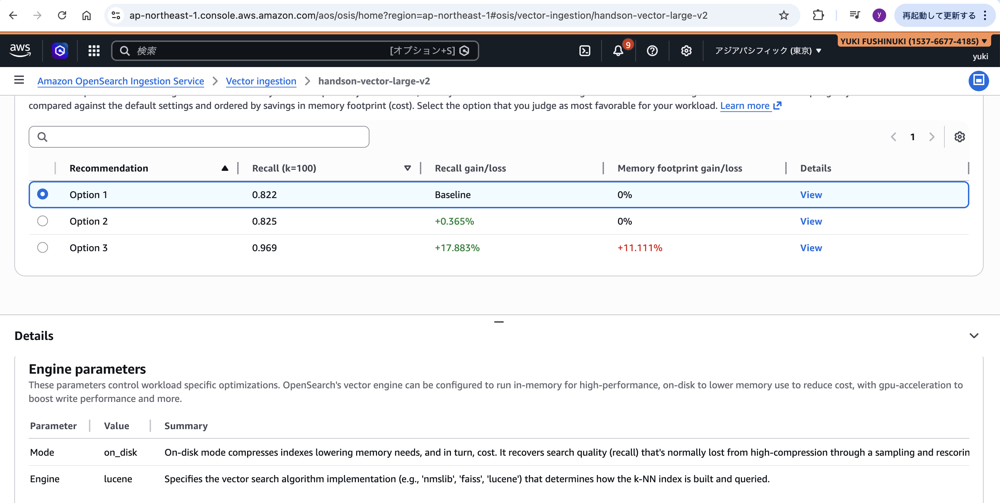
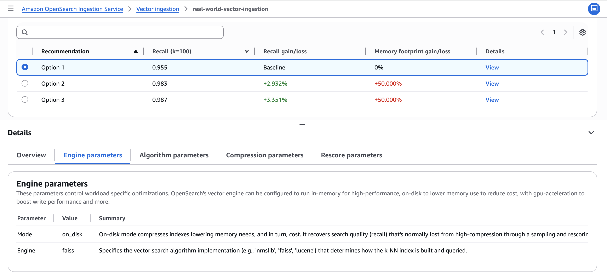
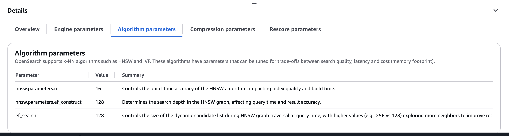
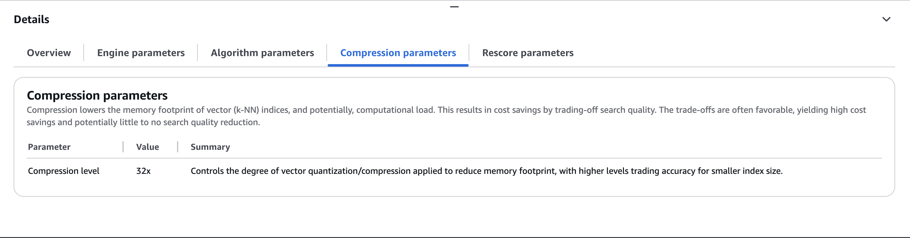

# Hands-on 2: managed vector ingestionで1000万件を投入する

このハンズオンでは、Amazon OpenSearch ServiceとAmazon OpenSearch Ingestion（OSIS）を使い、S3上のParquetデータをベクトルindexへ投入します。

主な手順では、過去のAuto-Optimize実測で得た`Faiss + HNSW + on_disk + 32x`の設定を固定して使います。AWSコンソールの操作に依存せず、構築、投入、検索、削除までコマンドで再現できます。

AWSの画面や利用可能な構成は変更されることがあります。書籍の画面を再現するのではなく、このREADMEの`main`にある手順を使ってください。書籍には設計判断と実測結果を残し、現在の実行方法とAWS固有の入力値はこのREADMEで更新します。

## AWS料金に関する注意

OpenSearchドメインとOSIS pipelineを作成するため、実行中はAWS料金が発生します。スクリプトは、次の確認変数がなければ課金リソースを作成しません。

```bash
CONFIRM_AWS_COSTS=yes
```

検証後は、必ず`./scripts/destroy.sh`まで実行してください。

## 検証済みの構成

2026年8月23日に、次の構成で1000万件の投入から削除まで確認しました。

- OpenSearch 3.1
- `or2.xlarge.search x1`
- gp3 512 GiB
- GPUベースのvector index build acceleration有効
- 1シャード、レプリカ0
- Faiss、HNSW、`on_disk`、`32x`
- OSIS 4〜8 OCU、S3 source 5 workers
- 1000万件、1024次元、200 Parquetファイル

実測では、投入開始から約83分で1000万件へ到達しました。初回検索は8,559 ms、ウォーム後は10〜16 msでした。

## 自動化している範囲

CDKとスクリプトが次を行います。

1. OpenSearchドメインとOSIS用IAM roleを作成する
2. CloudFormation出力からendpointとrole ARNを取得する
3. 固定mappingでindexを作成する
4. 読者自身のendpointとrole ARNを埋めたOSIS設定を生成する
5. pipelineを作成し、指定件数まで投入する
6. 件数、mapping、k-NN queryを検証する
7. pipeline、index、OpenSearchドメインを削除する

著者環境のendpointやAWSアカウントIDを入力する必要はありません。

## 前提

- Node.js 20以上
- AWS CLI v2
- AWS CDK v2
- `jq`、`curl`
- `cdk bootstrap`済みのAWSアカウント
- OpenSearch、OSIS、CloudFormation、IAM roleを作成できる権限
- `ap-northeast-1`を利用できること

OSISへIAM roleを渡すため、実行ユーザーには作成されたroleに対する`iam:PassRole`も必要です。共有データと検証済み構成をそろえるため、このハンズオンではリージョンを`ap-northeast-1`に固定します。

AWSプロファイルを使う場合は、実行前に設定します。

```bash
export AWS_PROFILE=your-profile
export AWS_REGION=ap-northeast-1
```

## まずsmokeテストを実行する

新規clone後、最初に事前確認を行います。この処理では課金リソースを作成しません。

```bash
git clone https://github.com/oimo23/opensearch-book-handson.git
cd opensearch-book-handson/02-managed-vector-ingestion
./scripts/preflight.sh
```

smokeモードは、先頭のParquet 1ファイルだけを読み込み、5万件の投入を確認します。1000万件すべてを走査しないため、OSISとindexの接続を短時間で確認できます。

```bash
MODE=smoke \
CONFIRM_AWS_COSTS=yes \
./scripts/run.sh
```

結果は`.handson/verification.json`へ保存されます。

```bash
jq . .handson/verification.json
```

確認後、リソースを削除します。

```bash
CONFIRM_DESTROY=yes ./scripts/destroy.sh
```

## 1000万件を投入する

smokeテストのリソースを削除した後、fullモードを実行します。1000万件の投入は時間と料金が増えるため、追加の確認変数が必要です。

```bash
MODE=full \
CONFIRM_AWS_COSTS=yes \
CONFIRM_10M_INGEST=yes \
./scripts/run.sh
```

投入と確認が終わったら削除します。

```bash
CONFIRM_DESTROY=yes ./scripts/destroy.sh
```

## スクリプトを個別に実行する

問題を切り分ける場合は、次の順序で個別実行できます。

```bash
./scripts/preflight.sh
CONFIRM_AWS_COSTS=yes ./scripts/deploy.sh
./scripts/create-index.sh
SOURCE_PREFIX=synthetic-cohere-like-parquet-10m-v2/data/part-00000.parquet \
./scripts/create-pipeline.sh
TARGET_COUNT=50000 ./scripts/monitor-ingest.sh
EXPECTED_COUNT=50000 ./scripts/verify.sh
CONFIRM_DESTROY=yes ./scripts/destroy.sh
```

主な環境変数は次のとおりです。

| 変数 | 既定値 | 用途 |
| --- | --- | --- |
| `AWS_REGION` | `ap-northeast-1` | AWSリージョン |
| `DOMAIN_NAME` | `handson-vector-<account>` | OpenSearchドメイン名 |
| `INSTANCE_TYPE` | `or2.xlarge.search` | データノードの種類 |
| `ALLOWED_CIDRS` | 実行マシンのIP `/32` | APIとDashboardsの接続元 |
| `PIPELINE_NAME` | `book-vector-10m-32x` | OSIS pipeline名 |
| `INDEX_NAME` | `syn10m_autoopt32x` | 投入先index名 |
| `SOURCE_PREFIX` | fullではデータフォルダ全体 | OSISが読み込むS3 key prefix |
| `TARGET_COUNT` | smokeでは50,000 | pipelineを停止する件数 |

## 共有データセット

投入元は次の公開S3 prefixです。

```text
s3://opensearch-book-handson-data-153766774185/synthetic-cohere-like-parquet-10m-v2/data/
```

バケット名には著者のAWSアカウントIDが含まれますが、これは全読者が参照する共有データの配置先です。OpenSearchのendpointとOSIS用IAM roleは、読者自身のAWSアカウントに作成されます。

## 書籍のケーススタディとの関係

書籍の第4章では、Auto-Optimizeで候補を比較した過去の実測と、同じ1000万件を複数方式で検索した結果をケーススタディとして扱います。一方、このREADMEの主手順はAuto-Optimizeの画面操作を再現するものではありません。実測から採用した`Faiss + HNSW + on_disk + 32x`を固定mappingとして使い、次の範囲をコマンドで追試します。

1. OpenSearchドメインとOSIS用IAM roleを作成する
2. 固定mappingでindexを作成する
3. 公開S3データをOSISで投入する
4. 件数、mapping、k-NN queryを検証する
5. 作成した課金リソースを削除する

Auto-Optimizeジョブの作成とrecommendation取得はAWSコンソールのUIに依存し、AWS CLIだけでは再現できません。UI変更の影響を読者へ持ち込まないため、現在の実行手順から外しています。

## Auto-Optimizeの画面記録

ここからの画像は、2026年にAWSコンソールでAuto-Optimizeを検証した際の記録です。現在の操作手順ではなく、どのような入力から候補が提示されたかを理解するための参考資料として掲載します。AWSコンソールの表示や項目名が変わった場合は、現在の画面を優先してください。

### Vector ingestionを開く

当時のコンソールでは、Amazon OpenSearch Ingestion Serviceのメニューから`Vector ingestion`を開きました。



Vector ingestionの画面には、データ準備、index設定、recommendation確認、投入という処理の流れが表示されていました。ジョブを作る場合は`Create vector ingestion job`から進みます。


### データソースと接続先を指定する

作成画面では、ジョブ名、S3 URI、接続先OpenSearchドメインを指定します。当時の画面では、Auto-Optimizeに対応するドメインだけが接続先候補に表示されました。


### 検索品質とレイテンシーの条件を指定する

`Configure index`では、ベクトルフィールド、距離指標、次元数、許容する近傍探索のRecall、レイテンシー要件を入力しました。これらの条件を変えると、提案されるengine、mode、圧縮率、HNSWパラメータも変わります。


この画像では説明用の試行として`space type=l2`を指定しています。現在配布している1000万件検証用mappingは`space_type=cosinesimil`です。画像の値を現在の手順へ転記せず、[`osis/syn10m-autoopt32x.index.json`](./osis/syn10m-autoopt32x.index.json)を正としてください。

### recommendationを比較する

Auto-Optimizeは、候補ごとに近傍探索のRecallとmemory footprintの増減を表示します。次の画像は別の試行例であり、Option 3ではメモリ使用量を増やす代わりにRecallを改善する候補が表示されています。入力データや要求条件が異なれば候補も変わるため、画面の数値そのものを一般化しないでください。



書籍で扱った1000万件・1024次元の例では、ベースライン候補として`faiss + on_disk + 32x`が提示されました。候補一覧とengineの詳細は次のように表示されました。



HNSWの設定は`m=16`、`ef_construction=128`、`ef_search=128`でした。



圧縮率には`32x`が提示されました。



結果を整理すると次のようになります。

| 項目 | 提案例 |
| --- | --- |
| データ条件 | 1000万件、1024次元 |
| ベースライン候補 | Option 1 |
| engine | `faiss` |
| mode | `on_disk` |
| 圧縮率 | `32x` |
| HNSWパラメータ | `m=16`、`ef_construction=128`、`ef_search=128` |
| Recall（k=100） | `0.955` |
| 追加候補 | Option 2: `0.983`、Option 3: `0.987` |
| 追加候補のメモリ増加 | いずれも`+50%` |

ここで表示されるRecallは、Auto-Optimizeが内部で行うsampled evaluationによる近傍再現率の推定値です。業務上の正解文書を取得できた割合でも、全件を厳密検索した結果でもありません。候補を絞るための値として使い、採用前には実際のデータとクエリでレイテンシーと検索品質を確認します。

## 固定32x構成の実測結果

2026年8月23日には、Auto-OptimizeのUIを使わず、配布している固定mappingで構築から削除までAWS実環境で確認しました。

| 確認項目 | 実測結果 |
| --- | --- |
| CloudFormation更新開始からドメイン利用可能まで | 約8分 |
| OSIS pipelineが`ACTIVE`になるまで | 約1分30秒 |
| 投入開始から1000万件到達まで | 約83分 |
| OpenSearch sinkの失敗件数 | 0件 |
| indexサイズ | 45,653,356,762 bytes（約42.52 GiB） |
| 投入中のCPU使用率 | 平均約39%、最大約45% |
| 投入中のJVM memory pressure | 平均約24.04%、最大約29.6% |
| 初回k-NN query | 8,559 ms |
| 2回目、3回目 | 10 ms、16 ms |

初回検索はグラフがキャッシュされていないため大きく遅延しました。2回目以降は同じqueryで10〜16 msとなり、上位結果も安定していました。この数値は固定した1つのqueryによる確認結果であり、多様なqueryを使ったp95や同時実行時の性能ではありません。

投入中には、S3 source coordinatorで一時的な`PartitionUpdateException: ConditionalCheckFailed`を2件確認しました。最終件数は1000万件と一致し、OpenSearch sinkの失敗と重複はなかったため、worker間の進捗更新競合による非致命的な事象と判断しました。途中のログに警告が出た場合も、最終件数とsink失敗件数を合わせて確認してください。

## 発展: S3 Vectors

同じ1000万件を`or2.medium.search`とS3 Vectorsで試す手順は、次を参照してください。

- [S3 Vectorsを`or2.medium.search`で比較する](./osis/s3vector_or2_medium_experiment.md)

通常のハンズオンとはmappingと削除順序が異なります。先に主な手順のリソースを削除してから実行してください。

## dry-run

AWSリソースを作成せず、コマンド生成とプレースホルダー置換を確認できます。

```bash
DRY_RUN=1 MODE=smoke ./scripts/run.sh
DRY_RUN=1 CONFIRM_DESTROY=yes ./scripts/destroy.sh
```

シェル構文、JSON、TypeScript、別アカウントでのCDK synth、dry-runをまとめて確認する場合は、次を実行します。

```bash
./scripts/test-local.sh
```
