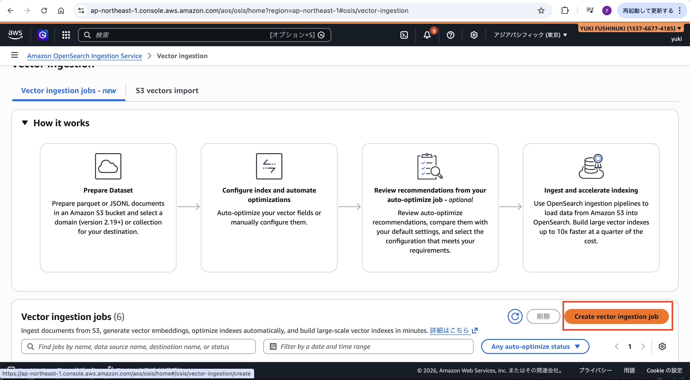
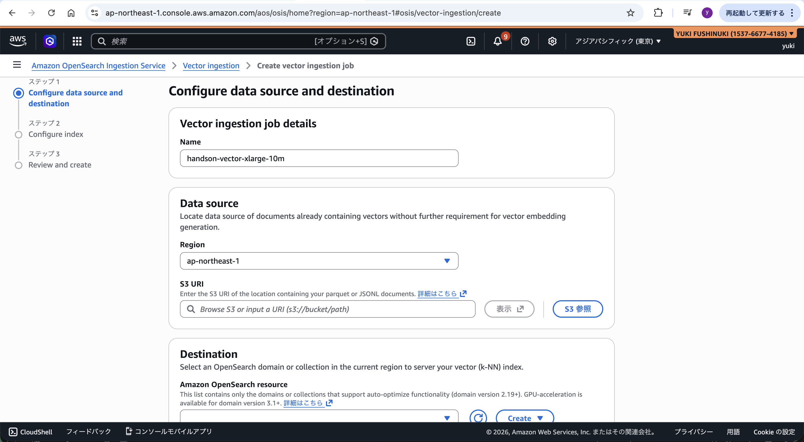
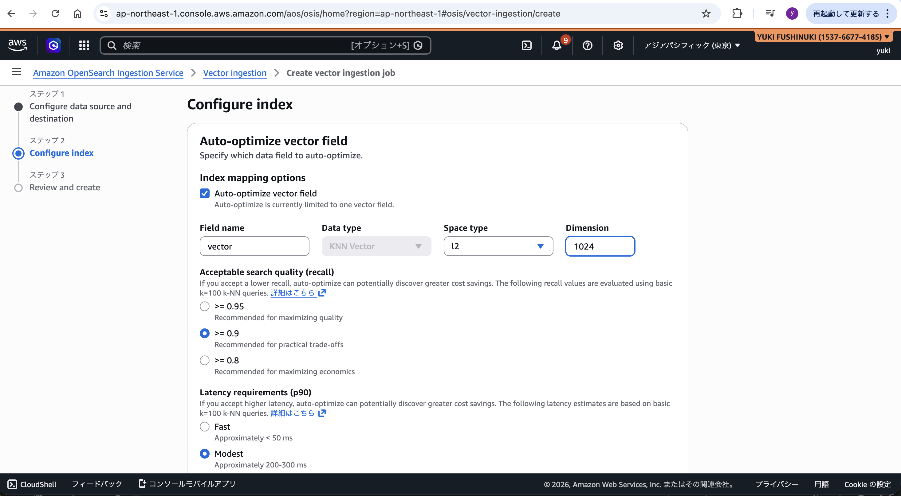

# Hands-on 2: OpenSearch Service で managed vector ingestion と auto-optimize を試す

## 注意: AWS 料金について

このハンズオンでは、Amazon OpenSearch Service のドメインや関連リソースを実際に作成します。これらのリソースは、作成したままにすると AWS 料金が継続して発生します。

ハンズオンが終わったら、必ず不要なリソースを削除するか、停止できるものは停止してください。特に OpenSearch ドメインは単価が高くなりやすいため、後片付けまで含めて実施することを前提に進めることを勧めます。

このディレクトリでは、Amazon OpenSearch Service の managed vector ingestion を使って、大規模ベクトルデータの自動最適化とインデックス構築を体験します。データセットは、あらかじめ S3 に配置済みの Parquet ファイルを利用します。

大きな流れは次の 3 段階です。

1. TypeScript CDK で OpenSearch ドメインを用意する
2. AWS コンソールから vector ingestion job と auto-optimize を実行する
3. Dashboards の Dev Tools で `k-NN` クエリを試す

## Step 1. OpenSearch ドメインをデプロイする

まずは OpenSearch ドメインを用意します。このディレクトリの CDK は、vector ingestion pipeline や auto-optimize job までは作らず、OpenSearch ドメインだけを起動します。これらは AWS コンソールから作成する前提です。

### この CDK が作るもの

- OpenSearch 3.1 のドメイン
- `or2.xlarge.search x1` の単一ノード構成
- public endpoint
- Dashboards にアクセスできる CIDR 制限付き resource policy
- 今後コンソールが作成する `VectorIngestionRole-*` からの書き込みを許可する policy
- GPU acceleration (`ServerlessVectorAcceleration`) を有効化した構成

### この CDK がまだ作らないもの

- vector ingestion pipeline
- auto-optimize job
- index template や index build

これらは、読者が AWS コンソールの UI から作成します。

### 前提

- Node.js 20 以上
- AWS CDK v2
- `cdk bootstrap` 済みの AWS アカウント

### 使い方

```bash
git clone https://github.com/oimo23/opensearch-book-handson.git
cd opensearch-book-handson/02-managed-vector-ingestion
npm install
npx cdk synth
npx cdk deploy
```

### よく使う context

デフォルトでは `or2.xlarge.search x1`、`512 GiB gp3` で作ります。  
`allowedCidrs` を指定しない場合は、CDK 実行マシンのグローバル IP を自動検出して `/32` を許可します。  
OpenSearch Service は `0.0.0.0/0` のような広すぎる access policy を fine-grained access control なしでは受け付けません。Dashboards を public endpoint で使う場合でも、少なくとも `/32` や社内ネットワーク単位の **CIDR 制限** を付けて deploy してください。

```bash
npx cdk deploy \
  -c domainName=handson-vector-xlarge \
  -c instanceType=or2.xlarge.search \
  -c instanceCount=1 \
  -c ebsVolumeSize=512 \
  -c allowedCidrs=203.0.113.10/32
```

複数 CIDR を許可する場合はカンマ区切りです。

```bash
npx cdk deploy -c allowedCidrs=203.0.113.10/32,198.51.100.0/24
```

IP 自動検出に任せる場合は、context を省略してそのまま deploy できます。

```bash
npx cdk deploy
```

### 出力

deploy が終わると、次の値が出ます。

- `DomainName`
- `DomainEndpoint`
- `DashboardsUrl`
- `AllowedCidrs`

### 注意

- Dashboards を public に開く場合でも、最低でも IP 制限はかけるほうが安全です。
- vector ingestion の UI を使うと、`VectorIngestionRole-*` という service role が作られます。本 CDK は、その role が後から domain に書き込めるように access policy を先に入れています。

## Step 2. vector ingestion から auto-optimize を行う

次に AWS コンソールから vector ingestion job を作成し、自動最適化を実行します。ここでは、事前に用意した S3 上の Parquet データセットを使います。

今回使う S3 prefix は次です。

```text
s3://realworld-opensearch-vector-data-153766774185/synthetic-cohere-like-parquet-10m-v1/data/
```

### 2-1. vector ingestion の作成画面を開く

Amazon OpenSearch Ingestion Service の画面から `Vector ingestion` を開き、新しい job を作成します。


### 2-2. データセットと接続先ドメインを指定する

- Data source: 上記の S3 prefix
- Destination: Step 1 で作成した OpenSearch ドメイン
- ベクトル列名: `vector`
- 次元数: `1024`



### 2-3. auto-optimize を有効にして recommendation を待つ

auto-optimize では、与えた recall 要件と latency 要件に合わせて、候補となるインデックス構成が提案されます。候補が出るまで数十分かかることがあります。



## Step 3. 推奨された設定で index build を行う

候補が表示されたら、内容を確認して `Build index` を実行します。これにより、推奨された設定で実際のインデックス構築が始まります。

確認したいポイントは次のとおりです。

- engine が何になったか
- `on_disk` か `in_memory` か
- compression level がどの程度か
- recall と memory footprint のトレードオフがどうなっているか



## Step 4. Dashboards の Dev Tools で `k-NN` クエリを試す

インデックス構築が終わったら、Dashboards の Dev Tools から `k-NN` クエリを投げて結果を確認します。1024 次元のベクトルをそのまま貼り付けると崩れやすいので、まず検索テンプレートを登録し、その後は短いクエリで呼び出します。

- [queries/dev_tools_queries.md](./queries/dev_tools_queries.md)
- [queries/dev_tools_query_syn10m_full.json](./queries/dev_tools_query_syn10m_full.json)
- [queries/register_search_template.md](./queries/register_search_template.md)
- [queries/register_search_template.json](./queries/register_search_template.json)

## 補足

- auto-optimize の recommendation は、全件に対する厳密評価ではなく、AWS 側の sampled evaluation に基づく推奨です。
- そのため、ここでの数値は「この条件ならこういう候補が有望」という判断材料として読みます。
- 本ハンズオンでは managed vector ingestion の流れを体験することを重視し、pipeline や index build の細かい設定は AWS 側の recommendation に委ねます。
