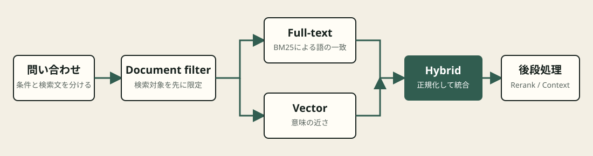

# ハンズオン3: ベクトル検索の弱点を補完するデモ

第5章「ベクトル検索の限界と実務上の補完策」に対応するハンズオンです。金融文書を模した180チャンクのコーパスに対して、検索方式による順位と取得文脈の違いを比較します。

- `vector`: ベクトル検索のみ
- `fulltext`: BM25による全文検索
- `exact`: `keyword`型フィールドを`term` queryで完全一致
- `hybrid`: 全文検索とベクトル検索を正規化して統合
- `hybrid_filter`: ハイブリッド検索の候補を文書名で限定
- `hybrid_rerank`: ハイブリッド検索の上位候補を多言語rerankerで再整列
- `hybrid_context`: ハイブリッド検索後に同じ親の前後チャンクを復元



## リポジトリを取得する

まだリポジトリを取得していない場合は、次の2行を実行します。

```bash
git clone https://github.com/oimo23/opensearch-book-handson.git
cd opensearch-book-handson/03-search-quality-lab
```

すでにclone済みの場合は、このページの「起動」から進めてください。

## この教材のデータについて

リポジトリに含まれる`data/corpus.jsonl`は、本ハンズオンのために作成した架空の金融文書です。実在の人物、企業、処分、規程を表すものではありません。

元の`fin-doc`検証アプリではHugging Face上の`TheFinAI/OCR_Task_JA`を利用していましたが、同データセットのカードには非商用目的の説明があります。そのため、商業版の読者向けリポジトリには同データセット、PDF、加工済みSQLiteを含めていません。詳しくは[DATA_SOURCES.md](./DATA_SOURCES.md)を参照してください。

## 事前条件

- Docker Desktopが起動していること
- 初回のモデル取得に必要なインターネット接続があること
- Dockerへ6GB程度のメモリを割り当てられること
- `curl`と`jq`を実行できること

初回起動では埋め込みモデル`cl-nagoya/ruri-v3-310m`を取得し、180件の教材チャンクをベクトル化します。`hybrid_rerank`を初めて実行するときは、別途`BAAI/bge-reranker-v2-m3`を取得するため時間がかかります。

本文の実測結果を再現できるように、OpenSearch、OpenSearch Dashboards、PythonのDockerイメージはdigestまで固定しています。Pythonの直接・間接依存は`backend/requirements.lock.txt`、2つのモデルはcommit SHAで固定しています。これらを更新する場合は、実測レスポンスと評価結果も同時に取り直してください。

## 起動

```bash
docker compose up --build
```

起動後は次を開きます。

- 金融文書検索デモ: http://localhost:8100
- OpenSearch Dashboards: http://localhost:5601
- OpenSearch API: http://localhost:9200

起動確認:

```bash
curl -s http://localhost:8100/api/health | jq
```

7方式の基本動作をまとめて検証する場合:

```bash
./scripts/smoke-test.sh
```

## 1. 条番号をベクトル検索だけで探す

```bash
curl -s http://localhost:8100/api/search \
  -H 'Content-Type: application/json' \
  -d '{"query":"第19条","mode":"vector","top_k":3}' | jq
```

条番号は意味の近さより文字列の一致が重要です。`vector`と`fulltext`を切り替えて順位を比較した後、`exact`で完全一致させます。

```bash
curl -s http://localhost:8100/api/search \
  -H 'Content-Type: application/json' \
  -d '{"query":"第19条","mode":"exact","top_k":3}' | jq
```

`fulltext`は分析済みの`text`フィールドをBM25で検索します。`exact`は`identifiers.raw`を`term` queryで検索するため、第19条だけが返ります。

## 2. ハイブリッド検索で候補を集める

```bash
curl -s http://localhost:8100/api/search \
  -H 'Content-Type: application/json' \
  -d '{"query":"ALPHA-10を現金化するまでの日数と主な価格変動要因","mode":"hybrid","top_k":5}' | jq
```

APIレスポンスの`request_body`には、実際にOpenSearchへ送った`hybrid`クエリが入ります。画面下部の「OpenSearchへ送ったリクエストを見る」でも確認できます。

## 3. filterで厳密条件を分離する

```bash
curl -s http://localhost:8100/api/search \
  -H 'Content-Type: application/json' \
  -d '{
    "query": "複雑な仕組債を販売した事例",
    "mode": "hybrid_filter",
    "top_k": 5,
    "filters": {
      "document_type": "case",
      "customer_age_gte": 75,
      "amount_yen_gte": 5000000,
      "case_outcome": "violation"
    }
  }' | jq
```

文書種別、年齢、金額、判定のような厳密条件は、自然文に混ぜず`filter`として渡します。この例では全文検索側とk-NN側の両方へ同じfilterを適用しています。

## 4. rerankで具体事例を上位へ移す

```bash
curl -s http://localhost:8100/api/search \
  -H 'Content-Type: application/json' \
  -d '{"query":"高齢顧客への複雑な金融商品の販売で、説明不足と管理者承認の欠落が問題になった事例","mode":"hybrid_rerank","top_k":3}' | jq
```

検索時の候補数は既定で10件です。180件すべてをrerankerへ渡すのではなく、OpenSearchが選んだ10件だけを再整列します。rerankは候補集合を新しく探す処理ではありません。

## 5. 前後チャンクを復元する

```bash
curl -s http://localhost:8100/api/search \
  -H 'Content-Type: application/json' \
  -d '{"query":"高齢顧客の継続購入で使える簡易承認の前提と例外","mode":"hybrid_context","top_k":5}' | jq
```

例外チャンクだけでは「この限り」が指す原則を判断できません。`hybrid_context`は検索に当たった子チャンクの`parent_id`を使い、同じ親に属するチャンクを`chunk_order`順で`context_chunks`へ格納します。同じ親文書は検索結果上で1件にまとめます。

## 6. 評価セットをまとめて実行する

```bash
python3 scripts/evaluate.py
```

`data/evaluation_queries.json`にはdev 50件、test 50件を収録しています。devはhybrid重みの調整にだけ使い、testは最終評価に使います。正解文書、期待文書、必須文脈チャンクはdevとtestで重複しないようvalidatorで検査します。

```bash
python3 scripts/evaluate.py \
  --split test \
  --output docs/results/test-results.json
```

カテゴリ別のHit Rate@3、Hit Rate@10、MRR@5、NDCG@5を出力します。文脈問い合わせでは正しい親文書を上位3件で取得できた割合、Context Completeness、展開した文脈のprecisionを分けて記録します。filterでは返却された全hitが構造化条件へ適合することを検査します。

初期の50問版は`data/evaluation_queries-v1.json`、実測結果は`docs/results/test-results-v1.json`へ保存しています。

データ自体を検証する場合:

```bash
python3 scripts/validate_dataset.py
```

著者がdevセットだけでhybrid重みを比較する場合:

```bash
python3 scripts/tune_hybrid.py
```

test結果を確認した後で、testクエリ、正解ラベル、検索設定を調整しないでください。

## Dashboardsで直接試す

検索パイプラインはアプリ起動時に`fin-doc-hybrid-pipeline`という名前で作られます。Dev Toolsでは、APIレスポンスの`request_body`から`body_vector.vector`を省略せずコピーし、次のエンドポイントへ送ります。

```text
POST fin-doc-search-demo-v3/_search?search_pipeline=fin-doc-hybrid-pipeline
```

## パラメータを変更する

```bash
cp .env.example .env
```

主な設定:

- `TOP_K`: 画面へ返す件数
- `CANDIDATE_SIZE`: hybridとrerankへ渡す候補数。教材の既定値は10件
- `HYBRID_KEYWORD_WEIGHT`: 全文検索スコアの重み
- `HYBRID_VECTOR_WEIGHT`: ベクトル検索スコアの重み
- `ENABLE_RERANK`: `false`にするとrerankモデルを読み込まない
- `EMBEDDING_MODEL_NAME`: 埋め込みモデル
- `RERANK_MODEL_NAME`: reranker

モデルを変更する場合は、次元数、入力prefix、ライセンス、用途を必ず確認してください。現在のmappingは768次元に固定しています。

## 片付け

コンテナだけを停止:

```bash
docker compose down
```

OpenSearchのデータとモデルキャッシュも削除:

```bash
docker compose down -v
```

## 注意点

- 初回のrerankはモデル読み込み時間を含むため、2回目以降と分けて計測してください。
- `took_ms`はOpenSearch検索、文脈復元、rerankの時間です。クエリの埋め込み生成、ブラウザ描画、通信時間は含みません。
- 本文の代表例は仕組みを理解するための制御された教材例です。一般的な品質判断には、代表例と分離したtestセットを使います。
- 教材コーパスは意図的にhard negativeを含みます。実データでは評価用クエリと正解集合を別途作る必要があります。
- モデルとライブラリのライセンスは[THIRD_PARTY_NOTICES.md](./THIRD_PARTY_NOTICES.md)を参照してください。
